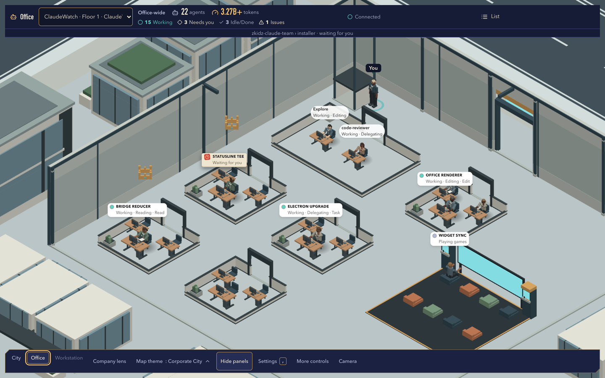
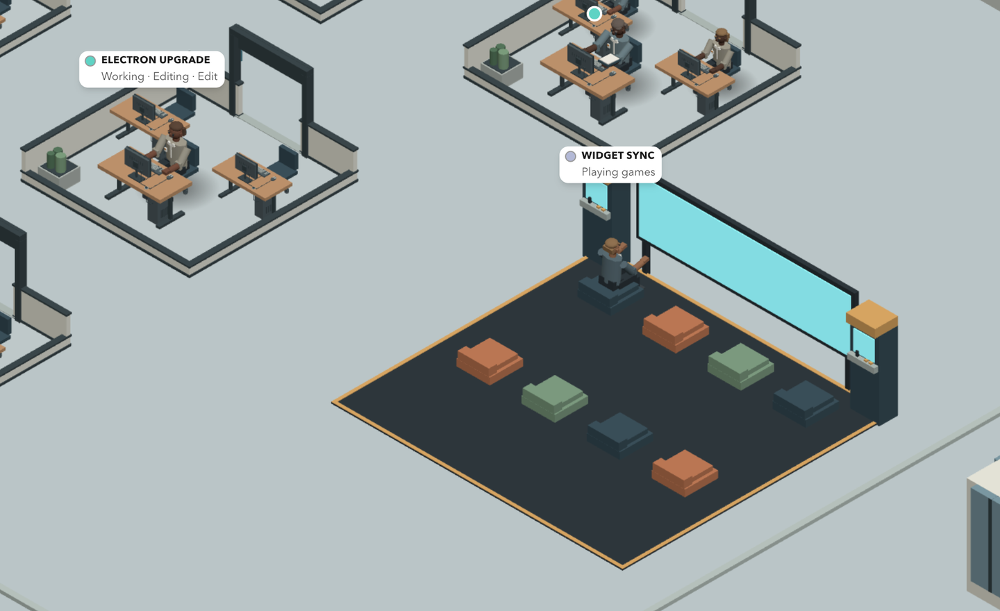
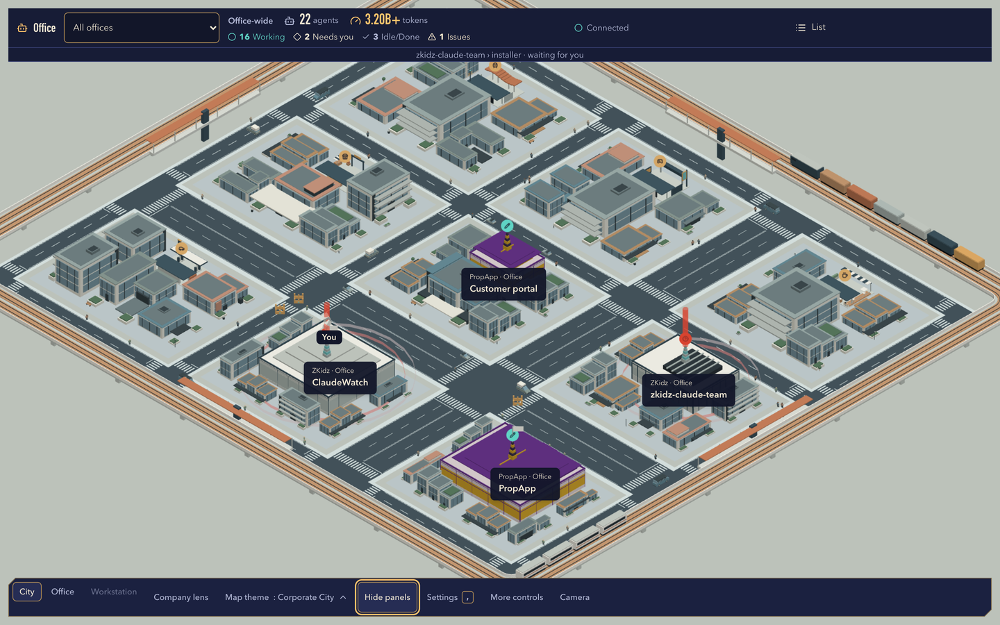
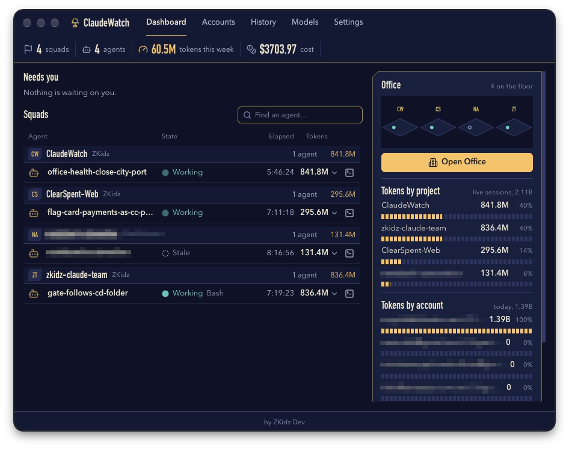
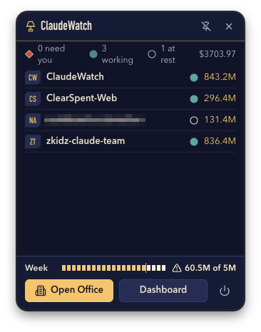
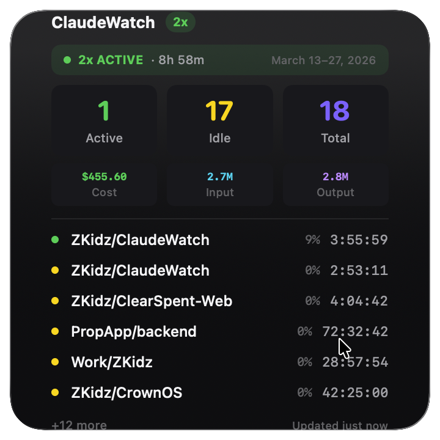

# ClaudeWatch

> See every Claude Code, Codex and OpenCode agent on your computer: a live dashboard, a menu-bar popover, a macOS widget, and the Office, an isometric city where each agent works at its own desk. Desktop app built with Electron, React, three.js and TypeScript.

---

## Table of Contents

1. [Overview](#overview)
   - [Screenshots](#screenshots)
   - [How It Works](#how-it-works)
2. [Download & Install](#download--install)
3. [The Office](#the-office)
4. [Prerequisites](#prerequisites)
5. [Quick Start](#quick-start)
6. [Development Setup](#development-setup)
7. [Architecture](#architecture)
8. [Main Process](#main-process)
9. [Platform Detection](#platform-detection)
10. [Configuration & Settings](#configuration--settings)
11. [Tray & Popover](#tray--popover)
12. [Notifications](#notifications)
13. [Auto-Updates](#auto-updates)
14. [Testing](#testing)
15. [Building for Production](#building-for-production)
16. [Releasing](#releasing)
17. [Project Structure](#project-structure)
18. [Design System](#design-system)
19. [Troubleshooting](#troubleshooting)
20. [Roadmap](#roadmap)
21. [Dependencies](#dependencies)

---

## Overview

ClaudeWatch finds the coding agents running on your computer and shows what each one is doing. It reads Claude Code, Codex and OpenCode sessions, including subagents and agent-team teammates, and groups them by company and project.

- **The Office**: a live isometric office and city. Every agent works at its own desk, idle agents play in their floor's game corner, and the city around it reacts to real activity.
- **Dashboard**: live counts, token usage per account, company, project and agent, rate limits, and a session list with filters and search.
- **Menu bar popover**: a compact view that opens when you hover over the tray icon.
- **macOS widget**: small, medium and large WidgetKit widgets with live stats.
- **Browser Office**: the same live city in your browser, view-only and local to your computer.
- **Notifications** when a task completes, an agent goes idle or a session ends.
- **Jump to the terminal**: focus the agent's terminal window, or its exact Orca pane.
- **Mac and Windows**: Apple silicon and Intel Macs; Windows x64 from 1.4.0.

### Screenshots

The Office and city shots use the built-in fixture sessions (`npm run office:preview`).

**The Office**: agents at their desks on a project floor, each card showing what the agent is doing:



**Game corner**: an idle agent plays in its floor's game corner while the others work:



**The agent city**: company offices, lit signs, token spires and the railway ring:



**Dashboard**: agents grouped into squads by project, tokens by project and account, and an Office overview (account and client names blurred):



**Tray popover**: who needs you, what is working, tokens per project and the weekly token bar (a client name blurred):



**macOS widget**: the large widget with live session stats, usage and the instance list:



### How It Works

```
┌───────────────────────────────────────────────────────────────────┐
│ Agent sessions on this computer                                   │
│  Claude Code · Codex · OpenCode, in any terminal or Orca pane     │
└───────────────┬───────────────────────────────┬───────────────────┘
                │ ps / lsof                     │ session registry, transcripts,
                │ (PowerShell on Windows)       │ rollouts, OpenCode database
                ▼                               ▼
┌──────────────────────────────┐  ┌──────────────────────────────────┐
│ Main process (src/main)      │  │ Bridge (src/bridge)              │
│  ProcessMonitor              │  │  Electron utility process: polls │
│  SessionTracker              │◄─┤  each provider; BridgeHost folds │
│  Notifications · Tray        │  │  the feed into one snapshot      │
│  Widget sync · Accounts      │  └────────────────┬─────────────────┘
└──────┬──────────────┬────────┘                   │ live feed
       │ IPC          │ stats.json                 ▼
       ▼              ▼              ┌──────────────────────────────────┐
┌──────────────┐ ┌────────────┐      │ Office window                    │
│ Dashboard    │ │ macOS      │      │  src/renderer/office-live runs   │
│ Popover      │ │ widget     │      │  the simulation (src/office/sim);│
└──────────────┘ └────────────┘      │  src/renderer/office draws it    │
                                     └────────────────┬─────────────────┘
                                                      │ same feed
                                                      ▼
                                     ┌──────────────────────────────────┐
                                     │ Browser Office (src/office-web)  │
                                     │  127.0.0.1:43127, view-only      │
                                     └──────────────────────────────────┘
```

---

## Download & Install

Download the latest release from [GitHub Releases](https://github.com/theangeloumali/ClaudeWatch/releases/latest).

| Platform            | File                                                             |
| ------------------- | ---------------------------------------------------------------- |
| Mac (Apple silicon) | `claudewatch-<version>-arm64.dmg`                                |
| Mac (Intel)         | `claudewatch-<version>-x64.dmg`                                  |
| Windows (x64)       | `claudewatch-1.4.0-setup.exe` from the [v1.4.0 release][win-rel] |

[win-rel]: https://github.com/theangeloumali/ClaudeWatch/releases/tag/v1.4.0

**Mac:** open the DMG and drag ClaudeWatch to Applications. The Mac build is signed but not yet notarised by Apple. If macOS says it cannot check the app on first open, open **System Settings › Privacy & Security** and choose **Open Anyway**.

**Windows:** the installer installs for your user and needs no admin rights. It is not code-signed yet, so SmartScreen may warn on first run: choose **More info**, then **Run anyway**.

ClaudeWatch starts in the menu bar (the system tray on Windows). Hover over the tray icon for the popover, or right-click it for **Open Dashboard** and **Open Office**.

---

## The Office

Open it from the dashboard's **Open Office** button or the tray menu.

- **Floors and desks**: each project gets a floor in its company's building, and each agent sits at its own desk. Subagents and teammates sit beside their lead. A robot's screen and card show what the agent is doing: reading, editing, running, thinking, delegating, or waiting on you.
- **Agents stay inside**: a new agent appears at its desk, and an agent whose session ends fades where it stands.
- **Game corner**: every office floor has a game corner with a wall screen, arcade cabinets and beanbags. An agent that stays idle walks over and plays until work calls it back to its desk.
- **The city**: landmarks, lit signs showing what each project is doing, a railway ring with stations and trains, citizens on the sidewalks and vehicles in their lanes. A real tool call sends a vehicle out on a work trip.
- **Live events**: token spires grow with today's spend, crowns mark the day's leaders, a beacon flags an agent that needs you, smoke shows errors and rate limits, fireworks mark token milestones, and a flag goes up when a turn finishes.
- **Navigation**: pan, zoom and orbit; a mini-map that shows your view and pans the city; **Follow** to keep an agent in frame; **Hide panels** for a clear view.
- **Company lens**: gives each company's offices one colour, with a card for each company.
- **Themes**: eight themes, set per company or project: Corporate City (default), Cyberpunk City, Samurai Empire, Orbital Garrison, Quiet Grove, Neo Edo Steam, Brass Workshop and Violet Court.
- **Office settings**: Town size, Detail level, Citizens, Vehicles, Game corner and Hide names, which replaces every company, project, session and account name with a role for screen sharing and recordings.

### Live Office in your browser

Right-click the ClaudeWatch menu-bar icon and choose **Open Office in Browser**.
Keep the app running: it serves the same live city at `http://127.0.0.1:43127/office.html`
and opens your default browser through a private, one-use launcher. Opening the plain
address without that launcher does not authorize access to session data.

This mode is local to this computer and view-only: it cannot send messages, answer permissions,
capture terminals or start agents. Browser themes, roof visibility and saved layouts are
stored separately from the native Office. Reopen through the tray after restarting the app;
the browser keeps its local choices. If port 43127 is occupied, the app reports it instead
of closing another program or moving your browser storage to a different address.

---

## Prerequisites

| Tool                                    | Version  | Purpose                       |
| --------------------------------------- | -------- | ----------------------------- |
| **Node.js**                             | >= 22.12 | Runtime (`engines` field)     |
| **npm**                                 | 10+      | Package manager (lockfile)    |
| **Git**                                 | Any      | Version control               |
| **Xcode** (macOS)                       | Latest   | Native modules and the widget |
| **Visual Studio Build Tools** (Windows) | 2019+    | Native compilation            |

### Verify Prerequisites

```bash
node --version    # v22.12.0 or higher
npm --version     # 10 or higher
git --version     # any version
```

On macOS, install the Xcode command line tools if they are missing:

```bash
xcode-select --install
```

---

## Quick Start

```bash
# 1. Clone the repository
git clone https://github.com/theangeloumali/ClaudeWatch.git
cd ClaudeWatch

# 2. Install dependencies
npm install

# 3. Run in development mode
npm run dev

# 4. The app starts in the menu bar: look for the tray icon (● 0)
```

The app starts hidden in the system tray. Hover over the tray icon to open the popover, or right-click for the context menu and select **Open Dashboard**.

> A development run uses the same settings file as an installed ClaudeWatch (`~/Library/Application Support/claudewatch/claudewatch.json` on macOS). Quit the installed app first if you do not want them to share settings.

To work on the Office scene without live sessions, `npm run office:preview` serves it with fixture data.

---

## Development Setup

### Install Dependencies

```bash
npm install
```

This also runs `electron-builder install-app-deps` as a postinstall hook to compile native Node modules for Electron's version of Node.

### Development Server

```bash
npm run dev
```

This starts `electron-vite dev`, which:

1. Builds the main process and preload scripts
2. Starts a Vite dev server for the renderer (with HMR)
3. Launches the Electron app connected to the dev server

Changes to renderer files reload instantly. Changes to main process files trigger a full restart.

### Available Scripts

| Script                     | Command                                               | Description                                                   |
| -------------------------- | ----------------------------------------------------- | ------------------------------------------------------------- |
| `npm run dev`              | `electron-vite dev`                                   | Development mode with HMR                                     |
| `npm run build`            | `electron-vite build && npm run build:office-web`     | Build the app and the browser Office                          |
| `npm run preview`          | `electron-vite preview`                               | Run the production build locally                              |
| `npm test`                 | `vitest run`                                          | Run all tests once                                            |
| `npm run test:watch`       | `vitest`                                              | Run tests in watch mode                                       |
| `npm run typecheck`        | `tsc` on `tsconfig.node.json` and `tsconfig.web.json` | TypeScript type checking                                      |
| `npm run lint`             | `eslint .`                                            | Lint the repository                                           |
| `npm run format`           | `prettier --write "src/**/*.{ts,tsx,css}"`            | Format source files                                           |
| `npm run office:preview`   | `vite --config vite.office-preview.config.ts`         | The Office with fixture data, in a browser                    |
| `npm run build:office-web` | Vite builds of the Office server and page             | Build the browser Office into `out/office-web`                |
| `npm run build:widget`     | `bash scripts/build-widget.sh`                        | Build the macOS widget extension                              |
| `npm run build:mac`        | Build + widget + `electron-builder --mac`             | Create macOS DMG and ZIP (arm64 and x64)                      |
| `npm run build:win`        | Build + `electron-builder --win`                      | Create the Windows installer                                  |
| `npm run build:linux`      | Build + `electron-builder --linux`                    | Create a Linux AppImage                                       |
| `npm run release:patch`    | `npm version patch && npm run publish:local`          | Bump the patch version, build, sign and publish from this Mac |
| `npm run release:minor`    | `npm version minor && npm run publish:local`          | Bump the minor version, build, sign and publish from this Mac |
| `npm run release:major`    | `npm version major && npm run publish:local`          | Bump the major version, build, sign and publish from this Mac |

### Verify Everything Works

```bash
# Run all checks in sequence
npm run typecheck && npm test && npm run lint
```

---

## Architecture

### Processes

| Process        | Runtime                  | Entry point                                     | Role                                                     |
| -------------- | ------------------------ | ----------------------------------------------- | -------------------------------------------------------- |
| **Main**       | Node.js                  | `src/main/index.ts`                             | Tray, windows, process monitoring, notifications, IPC    |
| **Bridge**     | Electron utility process | `src/bridge/index.ts`                           | Polls Claude Code, Codex, OpenCode and Orca for sessions |
| **Preload**    | Node.js (sandboxed)      | `src/preload/index.ts`, `src/preload/office.ts` | `window.api` for the dashboard and the Office            |
| **Renderer**   | Chromium                 | `src/renderer/main.tsx`                         | Dashboard, popover and settings (React)                  |
| **Office**     | Chromium                 | `src/renderer/office/main.tsx`                  | The Office window (React Three Fiber)                    |
| **Office web** | HTTP server in main      | `src/office-web/server.ts`                      | The view-only browser Office on port 43127               |

### Key Design Decisions

1. **Context isolation**: renderers cannot reach Node.js. Everything goes through the preload bridges (`window.api`), and the main process validates every argument.
2. **One snapshot, many views**: the bridge folds every provider's sessions into one snapshot. The dashboard, popover, tray, widget, Office window and browser Office all read it.
3. **The bridge runs only when needed**: `BridgeHost` (`src/main/bridge-host.ts`) starts it while something needs live data and keeps the folded snapshot, so a window that opens later starts from the current state.
4. **Shared simulation**: the Office simulation (`src/office/sim`) and the shared types (`src/shared/office`) are the same code in the native window and the browser.
5. **Platform abstraction**: process detection sits behind the `PlatformDetector` interface (`src/main/platform`).

---

## Main Process

### ProcessMonitor (`src/main/process-monitor.ts`)

Detects agent CLI processes, resolves each one's working directory and parses its flags. An instance is **active** while its CPU is above `cpuIdleThreshold` and **idle** below it.

### SessionTracker (`src/main/session-tracker.ts`)

Tracks instance lifecycles across polls: new appearances, status changes and exits. The dashboard, popover, tray, notifications and widget subscribe to its updates.

### SettingsStore (`src/main/store.ts`)

Persistent settings, session history and window positions, stored with `electron-store` in `claudewatch.json` inside the app's data folder:

- macOS: `~/Library/Application Support/claudewatch/claudewatch.json`
- Windows: `%APPDATA%\claudewatch\claudewatch.json`
- Linux: `~/.config/claudewatch/claudewatch.json`

### NotificationManager (`src/main/notifications.ts`)

Sends native notifications for task completion, idle and exited sessions. See [Notifications](#notifications).

### Office setup (`src/main/office-setup.ts`, `src/main/office-window.ts`)

Starts the bridge, opens the Office window and serves the browser Office (`src/main/office-browser.ts`).

---

## Platform Detection

### macOS (`src/main/platform/darwin.ts`)

Lists processes with `ps` and reads each one's working directory with `lsof -p <pid> -a -d cwd -Fn`.

### Windows (`src/main/platform/win32.ts`)

Lists processes through PowerShell (`Get-CimInstance Win32_Process`), using a shared PowerShell host (`src/shared/powershell-host.ts`).

### Sessions

Process detection finds running CLIs. The bridge (`src/bridge`) adds what each session is doing:

- **Claude Code**: the session registry under `~/.claude`, the process table for sessions without a registry entry, and transcripts for activity, subagents and teammates
- **Codex**: rollout files, including hosted subagents
- **OpenCode**: its local database
- **Orca**: terminal panes, so focusing an agent can jump to its exact pane

### Adding a New Platform

1. Create `src/main/platform/<platform>.ts`
2. Implement the `PlatformDetector` interface from `src/main/platform/darwin.ts`
3. Register it in `getPlatformDetector()` in `src/main/process-monitor.ts`

---

## Configuration & Settings

### Default Settings

From `DEFAULT_SETTINGS` in `src/renderer/lib/types.ts`:

```typescript
{
  pollingIntervalMs: 3000,       // How often to scan for processes
  cpuIdleThreshold: 3.0,         // CPU % below which an instance is idle
  launchAtLogin: false,          // Start with macOS/Windows
  openOfficeOnLaunch: false,     // Open the Office when ClaudeWatch starts
  minimizeToTray: true,          // Minimize windows to the tray
  notifications: {
    onTaskComplete: true,        // A task finished
    onIdle: true,                // An agent went idle
    onExited: true,              // A session ended
    onError: true,               // Errors
    sound: true,                 // Play notification sound
    pingSound: true,             // Ping when a task completes
    doNotDisturb: false,         // Suppress all notifications
    cooldownSeconds: 60,         // Minimum gap between notifications
    mutedProjects: []            // Projects that never notify
  },
  theme: 'dark',
  maxHistoryEntries: 100,        // Max stored history items
  weeklyTokenTarget: 5_000_000,  // The dashboard's weekly token bar
  staleThresholdMinutes: 30,     // When an idle session counts as stale
  watchAccounts: true            // Track usage per account
}
```

### Validation Ranges

| Setting             | Min | Max   | Default |
| ------------------- | --- | ----- | ------- |
| `pollingIntervalMs` | 500 | 60000 | 3000    |
| `cpuIdleThreshold`  | 0.1 | 100   | 3.0     |
| `maxHistoryEntries` | 1   | 10000 | 100     |

The ranges live in `src/shared/settings-ranges.ts`; `src/main/ipc-handlers.ts` validates settings before saving them.

---

## Tray & Popover

### Tray Icon

The app lives in the menu bar on macOS and the system tray on Windows.

**Tray title:** `● <active_count>`, the number of active instances.

| Action          | Result              |
| --------------- | ------------------- |
| **Hover**       | Opens the popover   |
| **Left click**  | Toggles the popover |
| **Right click** | Shows the menu      |

### Popover Window

A 320 × 420 frameless window anchored to the tray icon:

- How many agents need you, are working or are at rest, and the cost
- One row per project with its state and token total
- The weekly token bar
- **Open Office**, **Dashboard** and a quit button; the popover can be pinned open

### Context Menu (right-click)

```
ClaudeWatch — 5 instances
─────────────────────────────
🟢 MyProject — 00:05:32
🟢 OtherProject — 00:12:01
🟡 IdleProject — 01:23:45
─────────────────────────────
Open Dashboard
Open Office
Open Office in Browser
Check for Updates
─────────────────────────────
Quit
```

---

## Notifications

| Event                         | Title                  | Body                    | Setting                        |
| ----------------------------- | ---------------------- | ----------------------- | ------------------------------ |
| Task complete (active → idle) | "✅ Task complete"     | Project name + duration | `notifications.onTaskComplete` |
| Other change to idle          | "Claude finished"      | Project name + duration | `notifications.onIdle`         |
| Session ended                 | "Claude session ended" | Project name + duration | `notifications.onExited`       |

Controls in Settings: sound, the completion ping (`pingSound`), Do Not Disturb, a cooldown between notifications, per-project mutes and a test notification. Clicking a task-complete or idle notification focuses the agent's terminal.

---

## Auto-Updates

ClaudeWatch updates itself from GitHub Releases with `electron-updater`.

### How It Works

1. 10 seconds after start, the app checks GitHub Releases for a newer version
2. Checks repeat every 4 hours
3. You can also check from Settings or the tray menu
4. When an update is found, you choose whether to download it
5. After the download, **Install & Restart** installs it

`autoDownload` is `false`, and `autoInstallOnAppQuit` is `true`: a downloaded update installs on the next quit. Updates are off in development builds.

The updater follows GitHub's **Latest** release. Mac reads `latest-mac.yml` and Windows reads `latest.yml`; when the latest release has no Windows feed, Windows shows that as an update error instead of reporting that it is up to date.

### Update States

| Status          | Description              | UI                                |
| --------------- | ------------------------ | --------------------------------- |
| `idle`          | No check performed yet   | "Check" button                    |
| `checking`      | Querying GitHub Releases | Spinner                           |
| `available`     | New version found        | "Download" button + version badge |
| `not-available` | Already on latest        | "Check" button                    |
| `downloading`   | Downloading update       | Progress bar with percentage      |
| `downloaded`    | Ready to install         | "Install & Restart" button        |
| `error`         | Check or download failed | Error message + "Check" button    |

The manager is `src/main/auto-updater.ts`; the renderer side is `src/renderer/hooks/useUpdater.ts`.

---

## Testing

- **Runner:** Vitest 3
- **Environments:** Node for main, bridge and simulation tests; jsdom for renderer tests
- **Libraries:** `@testing-library/react`, `@testing-library/jest-dom`

Tests sit next to the code they cover (`*.test.ts`, `*.test.tsx`) or in a nearby `__tests__` folder. The suite has over 5,500 tests.

```bash
# Run all tests once
npm test

# Run tests in watch mode
npm run test:watch

# Run one area
npx vitest run src/office/sim

# Run one file
npx vitest run src/main/ipc-handlers.test.ts
```

---

## Building for Production

### Step 1: Build the Application

```bash
npm run build
```

This runs `electron-vite build` and then builds the browser Office:

- Main process and the bridge → `out/main/`
- Preload scripts → `out/preload/`
- Renderer and Office pages → `out/renderer/`
- Browser Office server and page → `out/office-web/`

### Step 2: Create Platform Installers

#### macOS (DMG and ZIP)

```bash
npm run build:mac
```

**Output:** `dist/claudewatch-<version>-arm64.dmg`, `dist/claudewatch-<version>-x64.dmg` and matching `.zip` files (the ZIPs feed auto-updates). The widget extension from `build/widget/` is copied into `Contents/PlugIns/` and re-signed by `scripts/afterSign.js`.

> Distribution outside the Mac App Store needs a Developer ID Application certificate for signing. Unsigned builds show a Gatekeeper warning.

#### Windows (NSIS installer)

```bash
npm run build:win
```

**Output:** `dist/claudewatch-<version>-setup.exe` (x64, with a choice of install folder).

#### Linux (AppImage)

```bash
npm run build:linux
```

**Output:** `dist/claudewatch-<version>-<arch>.AppImage`

### Build Configuration

Packaging settings are in `electron-builder.yml`: app id `com.zkidzdev.claudewatch`, product name ClaudeWatch, build resources in `build/` and output in `dist/`.

---

## Releasing

### Creating a Release

Releases are cut from the maintainer's Mac. There is no CI pipeline.

```bash
npm run release:patch   # 1.4.1 → 1.4.2
npm run release:minor   # 1.4.1 → 1.5.0
npm run release:major   # 1.4.1 → 2.0.0
```

Each one runs `npm version <type>`, which writes `release-notes.md` from the commits since the last tag, bumps `package.json` and creates the version commit and tag. It then runs `npm run publish:local`: build, build the widget, and `electron-builder --mac` for arm64 and x64. electron-builder reads `release-notes.md` (git-ignored) for the release body and fails without it.

What the machine needs:

| Need                                                                             | Why                                                                 | Without it                                                                                                                                |
| -------------------------------------------------------------------------------- | ------------------------------------------------------------------- | ----------------------------------------------------------------------------------------------------------------------------------------- |
| A "Developer ID Application" certificate of the app's team in the login keychain | Signing. Installed copies only accept an update signed by that team | Do not release: existing installs refuse the update                                                                                       |
| `GH_TOKEN` (or `GITHUB_TOKEN`) with `repo` scope in the environment              | Publishing the artifacts and `latest-mac.yml` to GitHub Releases    | The build still runs and leaves the artifacts in `dist/`, unpublished                                                                     |
| Apple notarisation credentials                                                   | `notarize: true` in `electron-builder.yml`                          | Notarisation fails. Until the credentials exist, build signed but not notarised (below); a fresh download then needs **Open Anyway** once |

After publishing, push the version commit and tag: `git push --follow-tags`.

#### A signed release without notarisation

```bash
npm run build && npm run build:widget
CSC_IDENTITY_AUTO_DISCOVERY=true npx electron-builder --mac --publish never -c.mac.notarize=false
gh release create v<version> dist/claudewatch-<version>-* dist/latest-mac.yml \
  --title <version> --notes-file release-notes.md
```

#### A local build without the release certificate

For a copy that runs on your own Mac only (it cannot auto-update to a Developer ID release):

```bash
npm run build && npm run build:widget
npx electron-builder --mac dir --arm64 --publish never \
  -c.mac.notarize=false -c.mac.type=development \
  -c.mac.identity="<an Apple Development certificate of the app's team>"
```

---

## Project Structure

```
ClaudeWatch/
├── build/                      # Build resources (icons, entitlements, built widget)
├── docs/                       # Plans and screenshots
├── resources/                  # Tray icons, sounds, the Claude Code statusline script
├── scripts/                    # Build, widget, changelog and signing helpers
├── widget/                     # macOS WidgetKit extension (Xcode project)
│
├── src/
│   ├── main/                   # Electron main process: tray, windows, monitor, IPC
│   │   ├── accounts/           # Usage per account
│   │   └── platform/           # darwin.ts, win32.ts process detection
│   ├── bridge/                 # Session discovery: Claude Code, Codex, OpenCode, Orca
│   ├── office/sim/             # The Office simulation: seating, walking, game corners
│   ├── office-host/            # The Office service shared by the window and the browser
│   ├── office-web/             # The view-only browser Office server
│   ├── preload/                # window.api for the dashboard and the Office
│   ├── renderer/               # React UI
│   │   ├── components/         # Dashboard, popover, settings
│   │   ├── office/             # The Office scene, HUD, themes and editor
│   │   └── office-live/        # The live feed that drives the simulation
│   └── shared/                 # Types and helpers shared across processes
│
├── electron.vite.config.ts     # Vite config (main/preload/renderer)
├── vite.office-*.config.ts     # Browser Office and preview builds
├── electron-builder.yml        # Packaging config
├── tailwind.config.ts          # Tailwind theme and design tokens
├── vitest.config.ts            # Test configuration
└── package.json                # Dependencies and scripts
```

---

## Design System

The colour tokens live in `tailwind.config.ts`. The Office's scene materials and palette rules are documented in `DESIGN.md`, and the product principles in `PRODUCT.md`.

---

## Troubleshooting

### macOS says it cannot check the app

The Mac build is signed but not yet notarised. Open **System Settings › Privacy & Security** and choose **Open Anyway**. You only need to do this once per download.

### Windows SmartScreen warns about the installer

The Windows installer is not code-signed yet. Choose **More info**, then **Run anyway**.

### "Open in Terminal" opens the wrong app

ClaudeWatch detects the terminal each session runs in and opens the folder there. Dedicated openers: Terminal.app, iTerm2, Warp, Kitty, WezTerm, Ghostty, VS Code and Cursor. Any other terminal (for example Alacritty or Hyper) falls back to Terminal.app. On Windows, folders open in Windows Terminal, or `cmd.exe` without it.

### No instances detected

1. Check that the agent CLI is running: `ps aux | grep claude`
2. The process must be the CLI, not the Claude desktop app
3. Try a shorter polling interval in Settings (for example 1 second)
4. Check Console.app for permission errors from `ps` or `lsof`

### Notifications not appearing

1. Check **System Settings › Notifications › ClaudeWatch**
2. Check that Do Not Disturb is off in ClaudeWatch's Settings
3. Check the individual notification toggles and per-project mutes

### Tailwind styles not rendering

The `css.postcss.plugins` block in `electron.vite.config.ts` overrides `postcss.config.js`. Keep the renderer config free of a `css` block so Vite finds `postcss.config.js`.

### Build fails on macOS

```bash
# Install the Xcode command line tools
xcode-select --install

# Clear build output and reinstall
rm -rf node_modules out dist
npm install
```

### Build fails on Windows

Install Visual Studio Build Tools 2019+ with the "Desktop development with C++" workload.

---

## Roadmap

### Completed

- [x] Process detection (macOS + Windows)
- [x] Live dashboard with stats, filters and search
- [x] System tray with context menu and hover popover
- [x] Session history tracking
- [x] Configurable notifications
- [x] Multi-terminal detection and opening, including Orca panes
- [x] Session type detection (CLI, VS Code, subagent)
- [x] Auto-updates from GitHub Releases
- [x] macOS widgets (WidgetKit): small, medium and large, with live stats and rate limits
- [x] Codex and OpenCode sessions alongside Claude Code
- [x] Subagents and agent-team teammates beside their lead
- [x] Token usage per account, company, project and agent
- [x] The Office: a live isometric office with eight themes
- [x] The agent city: landmarks, railway, token spires, beacons and live events
- [x] Agents stay in their office, with a game corner for idle agents
- [x] Hide names for screen sharing and recordings
- [x] View-only browser Office
- [x] Windows support

### Planned

- [ ] Linux process detection (`/proc` filesystem)
- [ ] Export session history (CSV/JSON)
- [ ] Custom alert rules (e.g., "notify if idle for > 5 minutes")

---

## Dependencies

### Runtime

| Package                   | Version | Purpose                         |
| ------------------------- | ------- | ------------------------------- |
| `@electron-toolkit/utils` | ^3.0    | Electron helpers (is.dev, etc.) |
| `electron-store`          | ^10.0   | Persistent JSON storage         |
| `electron-updater`        | ^6.0    | Auto-update support             |
| `lucide-react`            | ^0.400  | Icon library                    |

### Development

| Package                       | Version      | Purpose                       |
| ----------------------------- | ------------ | ----------------------------- |
| `electron`                    | ^44.7        | Desktop framework             |
| `electron-builder`            | ^26.15       | Native packaging              |
| `electron-vite`               | ^5.0         | Vite integration for Electron |
| `vite`                        | ^7.3         | Build tool                    |
| `react` / `react-dom`         | ~19.3        | UI framework                  |
| `three`                       | ~0.186       | 3D rendering for the Office   |
| `@react-three/fiber` / `drei` | ~9.8 / ~10.7 | React renderer for three.js   |
| `typescript`                  | ^5.7         | Type safety                   |
| `tailwindcss`                 | ^3.4         | Utility-first CSS             |
| `vitest`                      | ^3.2         | Test runner                   |
| `@testing-library/react`      | ^16.3        | Component testing             |
| `@vitejs/plugin-react`        | ^5.2         | React Fast Refresh            |
| `eslint`                      | ^9.0         | Linting                       |
| `prettier`                    | ^3.0         | Code formatting               |

---

_Last updated: 2026-10-18 (v1.4.1)_
